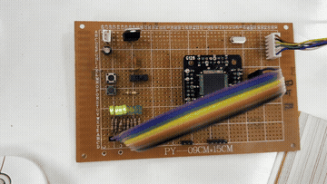
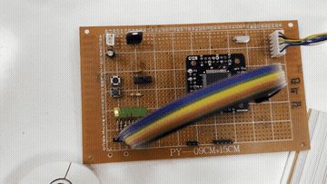
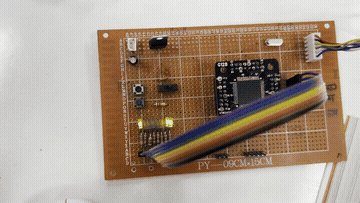

# 2주차: ATmega128 GPIO로 LED 제어

> 블로그: [빛돌 교육과정 2주차 - ATmega128을 이용한 LED 제어](https://blog.naver.com/homeless112/224166430914)

ATmega128 기본 회로를 직접 납땜하고, PORTC에 연결된 LED 8개를 제어했습니다.

| 파일 | 내용 |
| --- | --- |
| `led_alternate.c` | LED 4개씩 0.5초마다 교차 점등 |
| `led_one_by_one.c` | LED를 0번부터 7번까지 하나씩 순서대로 점등 |
| `led_stack.c` | LED가 위에서 떨어져 한 칸씩 쌓이는 애니메이션 (정방향 → 역방향) |

## 작동 영상

| 교차 점등 | 순차 점등 | LED 쌓기 |
| --- | --- | --- |
|  |  |  |

## 핵심

- `DDRC = 0xFF`로 PORTC 전체를 출력으로 설정합니다.
- 보드의 LED가 **Active Low**라서 0을 써야 켜집니다. 그래서 `PORTC = ~((1 << i) | stacked)`처럼 켜고 싶은 비트를 OR로 모은 뒤 전체를 반전했습니다.
- 쌓인 위치는 `stacked |= (1 << floor)`로 비트마스크에 누적합니다.

## 트러블슈팅

- 64핀 칩을 유튜브 영상처럼 한 번에 납땜하다 쇼트가 나서 칩을 하나 태웠습니다. 다리를 하나씩 인두로 납땜해 다시 만들었습니다.
- 비트 연산이 익숙하지 않아 LED 쌓기 로직에서 시간을 많이 썼습니다.
