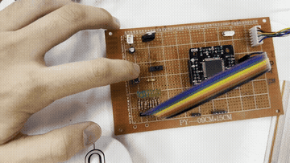
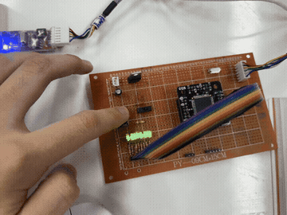
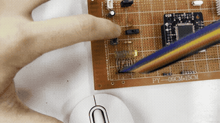

# 3주차: 외부 인터럽트 활용하기

> 블로그: [빛돌 교육과정 3주차 - 인터럽트 활용하기](https://blog.naver.com/homeless112/224166478344)

PORTE 4번 핀(INT4)에 누름 스위치를 달고, 버튼 입력을 폴링이 아닌 **외부 인터럽트**로 처리했습니다.

| 파일 | 내용 | 트리거 |
| --- | --- | --- |
| `int_toggle.c` | 버튼을 누를 때마다 LED 전체 켜기/끄기 토글 | 하강 엣지 |
| `int_hold.c` | 버튼을 누르고 있는 동안만 LED 켜기 | LOW 레벨 |
| `int_led_stack.c` | 버튼을 누를 때마다 LED가 하나씩 떨어져 쌓임, 8개가 차면 초기화 | 하강 엣지 |

## 작동 영상

| 토글 | 홀드 | LED 쌓기 |
| --- | --- | --- |
|  |  |  |

## 핵심

- **내부 풀업**: `DDRE = 0x00; PORTE = (1 << 4);`로 외부 저항 없이 스위치를 연결했습니다. 그래서 눌렸을 때 핀 값이 0입니다.
- **인터럽트 설정**: `EIMSK |= (1 << INT4)`로 INT4를 켜고, `EICRB`의 ISC41/ISC40으로 트리거 조건을 고릅니다. 마지막에 `sei()`로 전역 인터럽트를 허용합니다.
- ISR과 메인 루프가 함께 쓰는 변수는 `volatile`로 선언했습니다.

## 디바운싱

스위치 접점이 붙고 떨어질 때 기계적 진동으로 ON/OFF가 짧게 여러 번 반복되는 **채터링**이 생깁니다. 그대로 두면 인터럽트가 여러 번 들어갑니다.

~~~c
ISR(INT4_vect){
	_delay_ms(20);              // 진동이 가라앉을 때까지 대기
	if(!(PINE & (1 << 4))){     // 그래도 눌려 있으면 입력 확정
		state = 1;
	}
}
~~~

- 처음에는 디바운싱 없이 짰는데 **거의 동작하지 않을 정도**였습니다.
- 홀드(`int_hold.c`)는 엣지 트리거로 하면 채터링이 심해서 LOW 레벨 트리거를 썼습니다.
- 하드웨어 방식(커패시터 병렬)보다 소프트웨어 디바운싱이 더 확실했습니다.
